<div align="center">

<br/>

**`SIΞRRΛSKΛ—LAB · CΛNTO · ARTEFACT 002 · v3.7.0 · DESK OUTPUT`**

# CΛNTO

### The local desk for prop-firm futures traders

**Journal · risk · prop-plan replay · NinjaTrader 8 · an AI agent that proposes and never submits.**<br/>
One window on your machine. Your data stays there, unless you send it to a cloud model of your choice.

<br/>

<a href="https://github.com/0xSrk/C-NTO/releases/latest"></a>
<a href="https://github.com/0xSrk/C-NTO/releases/latest"></a>
<a href="https://github.com/0xSrk/C-NTO/releases/latest"></a>

<br/><br/>

[](#versions)
[](tests)
[](LICENSE)
[](docs/PONT-NINJATRADER.md)
[](docs/PROTOCOLE-AGENT.md)
[](https://www.electronjs.org)
[](https://www.typescriptlang.org)
[](docs/DESIGN.md)

<br/>

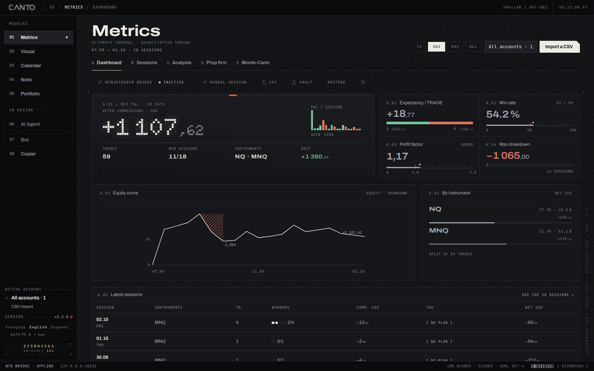

<sub><code>01 · MET</code> Metrics — 140 demo sessions: net P&L after fees, the K.04 gauge, the interactive equity curve with its drawdown.</sub>

<br/><br/>

**[`01 MET`](#metrics) · [`02 VIS`](#visual) · [`03 CAL`](#calendar) · [`04 NTE`](#notes) · [`05 PTF`](#portfolio) · [`06 AGT`](#ai-agent) · [`07 BOT`](#bot) · [`08 CPY`](#copier) · [`09 CRY`](#crypto)**

<br/>

**[Overview](#overview) · [What's new](#whats-new) · [Install](#install) · [First run](#first-run) · [The desk](#the-desk) · [The agent](#the-agent) · [NinjaTrader](#ninjatrader-8-bridge) · [Safety](#safety-by-design) · [Architecture](#architecture) · [Develop](#develop) · [Roadmap](#roadmap) · [Versions](#versions) · [Disclaimer](#disclaimer) · [License](#license)**

<br/>

</div>

---

<a id="overview"></a>
<a id="in-short"></a>

## Overview

CΛNTO is the desk of **SIΞRRΛSKΛ Lab** for traders who run prop-firm accounts on **CME Group futures** — Nasdaq, S&P, Russell, Dow, crude, gold, euro FX, and their micros — next to NinjaTrader 8. Nine modules share one window and one vault on your disk. The desk measures what you did, watches what you are doing against your plan and your own rules, and gives an AI agent the same view, while the main process, not the model, holds the API key and guards every order. Beside the futures desk, an optional crypto tab, off until you turn it on, follows crypto markets from public exchange data.

<table>
<tr>
<td width="50%" valign="top">

**Local by design**<br/>
One window, one vault on your disk. The journal needs no server. The interface cannot reach an outside host on its own, and every gateway listens on `127.0.0.1` only.

</td>
<td width="50%" valign="top">

**Numbers that hold**<br/>
P&L recomputed from prices and the CME contract registry. Profit factor before and after fees, confidence intervals, and a statistical rail before a time slot or a setup is called an edge.

</td>
</tr>
<tr>
<td width="50%" valign="top">

**Built around your prop plan**<br/>
EOD or intraday trailing, or a static drawdown, replayed day by day: the margin to the floor dated at the last session's low, the daily loss, consistency, and the odds of ruin before the target.

</td>
<td width="50%" valign="top">

**An agent that proposes. You decide.**<br/>
It reads the whole desk and your rules, prepares the brief and the debrief, and may propose an order on a Sim account. The main process guards it; you confirm each one.

</td>
</tr>
</table>

---

<a id="whats-new"></a>
<a id="whats-new-in-370"></a>

## What's new in 3.7.0

> [!NOTE]
> **v3.7.0 · 2026-10-26.** The same five points open the Release notes (French and English) and the version journal inside the desk (French, English and Spanish).

- **Visual system 4.0 « ΟΡΟΣ ».** Visual system 4.0 « ΟΡΟΣ »: the Lab’s night, ivory and gold. Gold marks what is alive (the LED, the last price, “now”); red now marks level 3 only, and nothing reacts to hover any more.
- **The Lab’s signature, seal and a single barcode.** The Lab’s signature in every detail: HUD plates bound to the desk’s real state, cartouches, module emblems and Ligne V2 components; the Horizon seal strikes at start-up and closes the lock, and the status bar keeps the chassis black, signed with an eleven-bar code between braces.
- **The AUBE launcher, rebuilt.** AUBE launcher rebuilt: the horizon draws itself, the gold LED settles on the tip of the Λ, version readings print; on launch, everything folds back onto the horizon. A key press skips it; reduced motion is respected.
- **AI Agent and the cloud agent.** AI Agent opens on the cloud agent’s report folder: a Managed Agents agent runs every day at Anthropic, on your organization’s API credits, and drops its report; the desk pulls it without sending anything. Install and runs go through a dialog, each run is capped; conversation and options each have their own view.
- **Kill switch and DOMPurify.** Kill switch: the level-3 band shows even when the NinjaTrader AddOn is not connected. DOMPurify moves to 3.4.17, past the critical advisories.

NinjaTrader AddOn **2.2.0** is unchanged. Full notes: [Release v3.7.0](https://github.com/0xSrk/C-NTO/releases/tag/v3.7.0).

---

<a id="install"></a>
<a id="installer"></a>
<a id="get-started"></a>

## Install

| Platform | Download | Runs on |
|---|---|---|
| **macOS** | [**Universal DMG**](https://github.com/0xSrk/C-NTO/releases/download/v3.7.0/CANTO-3.7.0-mac-universal.dmg) · [zip](https://github.com/0xSrk/C-NTO/releases/download/v3.7.0/CANTO-3.7.0-mac-universal.zip) | macOS 12 or later, Apple silicon and Intel |
| **Windows** | [**x64 setup**](https://github.com/0xSrk/C-NTO/releases/download/v3.7.0/CANTO-3.7.0-win-x64-setup.exe) · [ARM64 setup](https://github.com/0xSrk/C-NTO/releases/download/v3.7.0/CANTO-3.7.0-win-arm64-setup.exe) · [x64 portable](https://github.com/0xSrk/C-NTO/releases/download/v3.7.0/CANTO-3.7.0-win-x64-portable.exe) · [ARM64 portable](https://github.com/0xSrk/C-NTO/releases/download/v3.7.0/CANTO-3.7.0-win-arm64-portable.exe) | Windows 10 and 11 |
| **Linux** | [**AppImage x64**](https://github.com/0xSrk/C-NTO/releases/download/v3.7.0/CANTO-3.7.0-linux-x86_64.AppImage) · [deb amd64](https://github.com/0xSrk/C-NTO/releases/download/v3.7.0/CANTO-3.7.0-linux-amd64.deb) · [AppImage ARM64](https://github.com/0xSrk/C-NTO/releases/download/v3.7.0/CANTO-3.7.0-linux-arm64.AppImage) · [deb ARM64](https://github.com/0xSrk/C-NTO/releases/download/v3.7.0/CANTO-3.7.0-linux-arm64.deb) | x64 and ARM64 |

The installers need neither Node.js nor a clone of the repository. Each Release lists every file in `SHA256SUMS.txt`, signed with the Lab's Ed25519 key: the desk's built-in update refuses an installer whose signature is missing, foreign, or bound to another version ([docs/PUBLICATION.md](docs/PUBLICATION.md)).

> [!IMPORTANT]
> The NinjaTrader 8 AddOn (`CantoBridge.cs`) is compiled by you, inside NinjaTrader 8 on Windows (F5); this repository does not compile it. Setup: [NinjaTrader 8 bridge](#ninjatrader-8-bridge).

<details>
<summary><b>macOS</b> — Gatekeeper, NinjaTrader on another machine</summary>

<br/>

1. Open the DMG and drag **CΛNTO** into **Applications**.
2. First launch: right-click the app › **Open**. The app is not signed or notarized by Apple, so Gatekeeper asks once.
3. Metrics › NinjaTrader bridge creates the CSV folder and watches it ([the bridge](#ninjatrader-8-bridge)).

NinjaTrader 8 runs on Windows. The AddOn writes its CSV files there; the macOS desk reads that folder when it is local, shared, or synced (Syncthing, network share, copy). Everything else — metrics, calendar, notes, agent, vault — is native on the Mac. Real time, orders and the Copier need the desk on the Windows machine that runs NinjaTrader 8.

</details>

<details>
<summary><b>Windows</b> — wizard, portable build, start-up log</summary>

<br/>

1. Run `CANTO-3.7.0-win-x64-setup.exe` (`arm64` on Windows on ARM), choose the folder, then open **CΛNTO** from the Start menu. No-install variant: `CANTO-3.7.0-win-x64-portable.exe`.
2. NinjaTrader 8 — real time, AddOn, CSV folder: [the bridge](#ninjatrader-8-bridge).

**Nothing opens after a click?** CΛNTO runs a single instance: a second click brings the open window to the front. Every start is logged to `%APPDATA%\CΛNTO\logs\main.log`, and a start-up error is shown in a dialog rather than closing silently. If that log is not even created, Windows stopped the executable before it ran: the installer is not code-signed, so **Smart App Control** or an antivirus can block it. Check *Windows Security › App & browser control*, or use the source install below.

</details>

<details>
<summary><b>Linux</b> — AppImage, deb, sessions without a GPU</summary>

<br/>

- **AppImage** (no system install): `chmod +x CANTO-3.7.0-linux-x86_64.AppImage && ./CANTO-3.7.0-linux-x86_64.AppImage`
- **Debian / Ubuntu**: `sudo apt install ./CANTO-3.7.0-linux-amd64.deb`, then launch `canto` or **CΛNTO** from the menu.
- **NinjaTrader**: as on macOS, the Linux desk imports the CSV files the AddOn writes on Windows ([the bridge](#ninjatrader-8-bridge)); real time, orders and the Copier need the desk on the NinjaTrader machine.

Without a GPU (remote session, no `/dev/dri`), Chromium can leave the window black and quit. The desk then switches to software rendering on its own, including at the next launch. Force it with `CANTO_DISABLE_GPU=1`.

</details>

<details>
<summary><b>From source</b> — Node 22.12+, the launcher, every platform</summary>

<br/>

Requires [Node.js](https://nodejs.org) **22.12 or newer** and npm (Electron refuses Node 20).

```bash
git clone https://github.com/0xSrk/C-NTO.git
cd C-NTO
npm install
npm run launch
```

The launcher — `npm run launch`, or `CANTO.cmd` · `./CANTO.sh` · `CANTO.command` — opens the desk. Other commands: [Develop](#develop).

On Windows, `CANTO.cmd` downloads Electron without the `extract-zip` native module, which Smart App Control often blocks. Allow one to two minutes on the first run.

</details>

<details>
<summary><b>Updating</b> — installer or git clone</summary>

<br/>

The desk checks GitHub at start-up; **Update and relaunch** turns amber when a version is ready.

| Install | What the button does |
|---|---|
| **Installer** | Compares with the latest published Release (drafts and pre-releases ignored), downloads the installer for this machine with live progress, verifies it against the signed `SHA256SUMS.txt`, then installs natively: the Windows setup runs silently in place and relaunches, a Linux AppImage is replaced and relaunched, a macOS DMG or a Linux deb is opened for you. The system proxy is honored. The check reads the Releases without signing in: while the repository is private it cannot see them and reports *Could not reach GitHub*. Download the new installer from the Release page and run it over the current install; the data folder is kept. |
| **Git clone** | `git pull --ff-only origin main`, `npm install`, then relaunches the launcher. A dirty working tree asks before stashing. |

</details>

<details>
<summary><b>Data folder, logs and vault</b></summary>

<br/>

**Data folder** (vault, bridge state, language, logs): `%APPDATA%\CΛNTO` on Windows, `~/Library/Application Support/CΛNTO` on macOS, `~/.config/CANTO` on Linux. Every start is logged to `logs/main.log` inside it.

**Vault export.** JSON export `canto-vault-v2` (v1 still read): sessions, trades and open lots, notes and their links, calendar, portfolio, settings, copier accounts, automations. The API key is never exported. A heavy option adds bars and agent messages; a daily copy goes to a folder you choose.

</details>

---

<a id="first-run"></a>

## First run

Every install opens on the **launcher** — desk language, version check, then the circuit transition into the desk (`--desk` skips it).

<table>
<tr>
<td width="50%">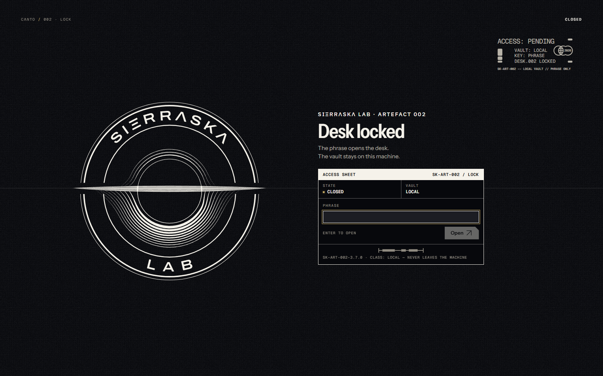</td>
<td width="50%">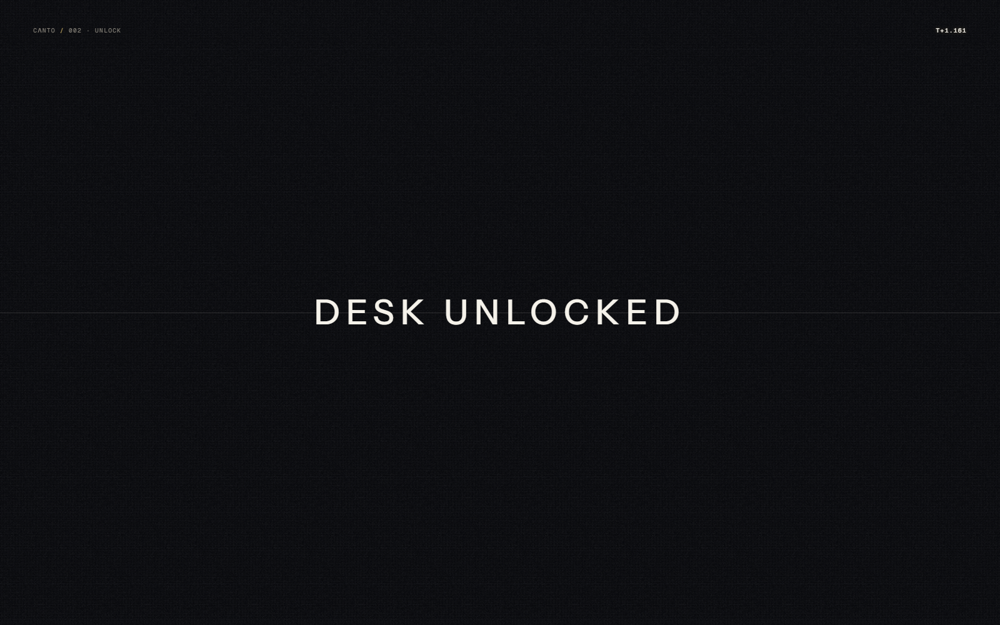</td>
</tr>
<tr>
<td><sub><b>Arrival</b> — the desk stays closed. SIΞRRΛSKΛ Lab · Artefact 002 above the plate.</sub></td>
<td><sub><b>Desk Unlocked</b> — drawn in the center, then the desk splits onto the modules.</sub></td>
</tr>
</table>

1. **Bring your journal.** Metrics › **Import a CSV**: a NinjaTrader *Trades* or *Executions* export, or a CΛNTO CSV. To explore first, **Load a demo dataset** (140 sessions).
2. **Set your plan and your rules.** Metrics › ⚙ **Desk settings**: the tracked prop-firm plan and account, then *Discipline* — max daily loss, trades per day, catalyst window, revenge window, allowed instruments.
3. **Connect NinjaTrader 8.** Compile the AddOn once, then **Write the NinjaTrader configuration** in Metrics › NinjaTrader bridge. See [the bridge](#ninjatrader-8-bridge).
4. **Meet the agent.** `06 · AGT`: pick a provider preset — a local model (Ollama, LM Studio) or a cloud API with your own key — then **Brief** before the open and **Debrief** after the close.

---

<a id="the-desk"></a>

## The desk

| | Module | What it does | Status |
|---|---|---|---|
| <code>01&nbsp;·&nbsp;MET</code> | [Metrics](#metrics) | Journal of up to 1,000 sessions, quantitative engine, risk and context, prop-plan replay, Monte Carlo | Live |
| <code>02&nbsp;·&nbsp;VIS</code> | [Visual](#visual) | Registry candles, an indicator catalog, a session projected, NinjaTrader live bars on request | Live |
| <code>03&nbsp;·&nbsp;CAL</code> | [Calendar](#calendar) | Official macro calendars, CME expirations, the note of the day | Live |
| <code>04&nbsp;·&nbsp;NTE</code> | [Notes](#notes) | Markdown vault, `[[wiki]]` links, a graph, a branch from a selection | Live |
| <code>05&nbsp;·&nbsp;PTF</code> | [Portfolio](#portfolio) | Consolidated net value, exposure, distance to prop thresholds, projection | Live |
| <code>06&nbsp;·&nbsp;AGT</code> | [AI agent](#ai-agent) | Reads the desk, briefs and debriefs, proposes Sim orders you confirm; local MCP gateway | Prototype · in design |
| <code>07&nbsp;·&nbsp;BOT</code> | [Bot](#bot) | Automaton workshop under imposed guardrails | Design · no orders |
| <code>08&nbsp;·&nbsp;CPY</code> | [Copier](#copier) | Position-based replication from a master to Sim followers | Sim only · disarmed on launch |
| <code>09&nbsp;·&nbsp;CRY</code> | [Crypto](#crypto) | Live crypto chart with its CVD, market temperature and local alerts; read and driven by the agent | Optional · off by default |

<a id="metrics"></a>
<a id="métrique"></a>
<a id="01-mtr"></a>

<div align="center">

**`01 · MET · METRICS · ULTIMATE JOURNAL · QUANTITATIVE ENGINE`**

</div>

### Metrics

Five views — **Dashboard · Sessions · Analysis · Prop firm · Monte Carlo** — on a pure TypeScript engine (`src/engine`) that never touches the interface.

- **A journal you can trust.** Up to 1,000 sessions, each with its account, its CME trading date (Globex, 18:00 New York) and its trades; past that, a warning and an export, never a silent drop. P&L is recomputed from price × point value (the registry cites CME Group), commissions deducted.
- **Ratios with their uncertainty.** Profit factor before and after fees, expectancy in $ and in R, Sharpe / Sortino / Calmar with intervals, SQN, Kelly, MAE / MFE, drawdown and recovery.
- **Risk and R.** Each trade carries its initial stop and target; risk comes from the stop, else from the risk you entered, else from a fixed risk per contract.
- **Reading by context.** A sheet per session — Garman-Klass volatility, regime and band, ATR, the day's releases — and your results read along one axis at a time. A verdict needs 30 distinct days and must pass the rail; otherwise the tab says no marker is solid.
- **Your prop plan, replayed.** Versioned plans (EOD or intraday trailing, or static; lock, daily loss, consistency, minimum days) replayed day by day, with the K.04 margin to the floor dated at the last session's low.
- **Monte Carlo.** A bounded i.i.d. bootstrap with a reproducible seed: percentiles, ruin and target probabilities.

<table>
<tr>
<td width="50%">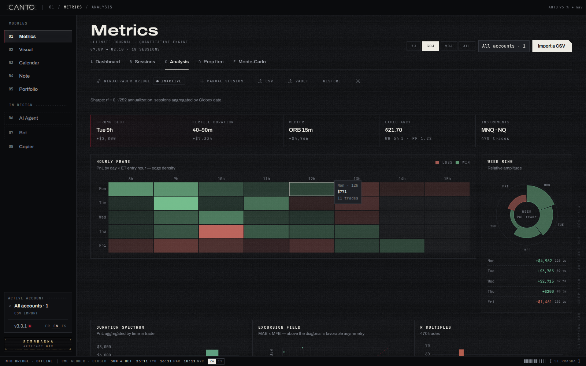</td>
<td width="50%">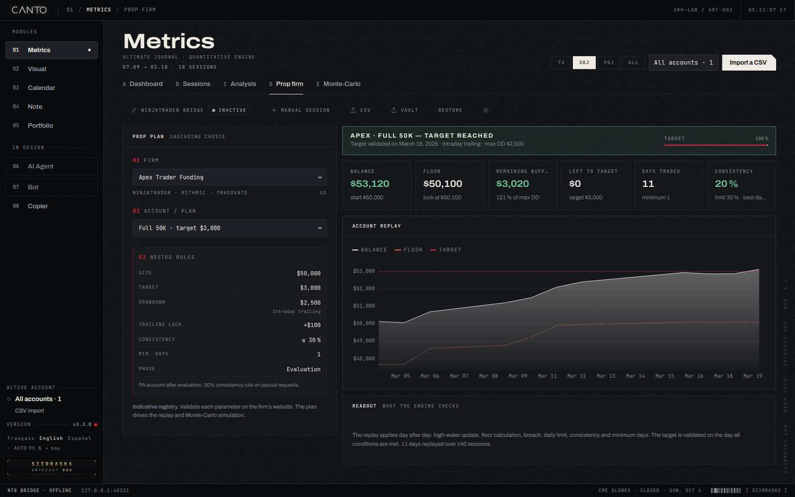</td>
</tr>
<tr>
<td><sub><b>Analysis</b> — reading by context, week ring, duration spectrum, excursion field, R multiples.</sub></td>
<td><sub><b>Prop firm</b> — an Apex Full 50K replay: balance, floor, target, consistency.</sub></td>
</tr>
<tr>
<td width="50%">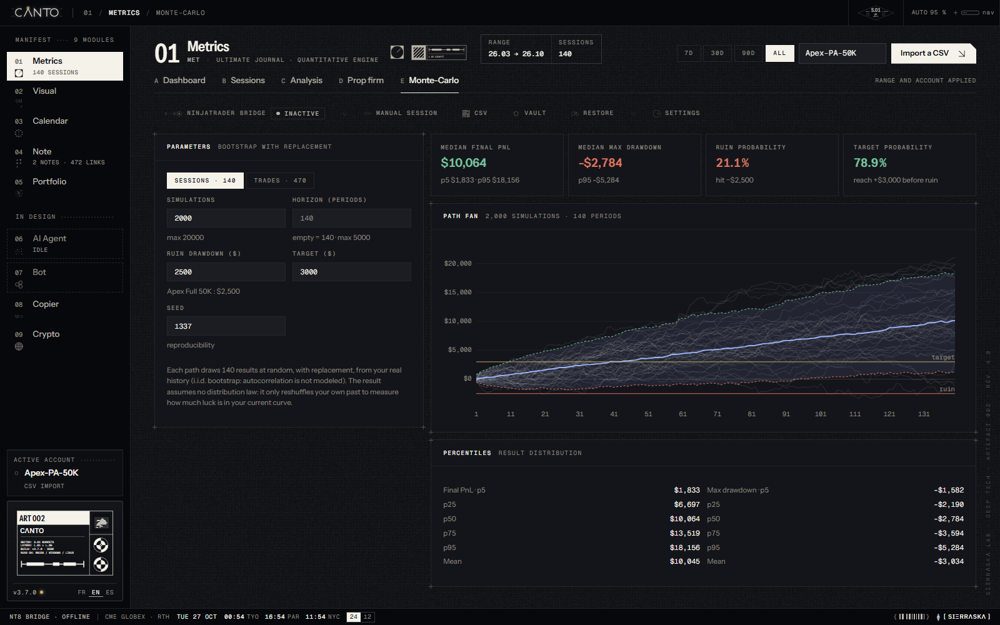</td>
<td width="50%">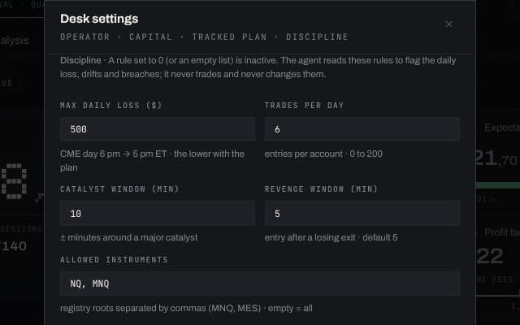</td>
</tr>
<tr>
<td><sub><b>Monte Carlo</b> — 2,000 paths, ruin before target, the percentile table.</sub></td>
<td><sub><b>Discipline</b> — your numeric rules, read by the desk, the agent and the guards.</sub></td>
</tr>
</table>

<details>
<summary><b>Reference</b> — what is computed, import formats</summary>

<br/>

| Family | What is computed |
|---|---|
| Trade | Profit factor after and before fees, payoff, expectancy ($ and R), win rate, SQN (Van Tharp: on R when every trade has a risk, otherwise on $ P&L), Kelly, streak z-score, MAE / MFE, edge ratio, capture ratio |
| Day | Sharpe with **rf = 0** over the period's trading days (a day without a session counts 0), annualized by **√252**, Sortino, Calmar (**linear** annualized return over drawdown, not a CAGR), max and current drawdown, time to recovery, share of winning sessions, consistency as the best day's share of net profit |
| Reliability | Expectancy with a confidence interval by blocks of days, ratio intervals, a stability watch (CUSUM, autocorrelations). A slot, a duration or a strategy is a marker only with enough trades, a permutation test corrected for false discoveries (Benjamini-Hochberg), and the same sign with at least half the size on the second half of the journal |
| Direction | Long / short, entry hour in New York, weekday of the CME session, instrument |
| Prop firm | EOD trailing, intraday trailing or static; lock, daily loss, consistency, minimum days; passed on the day every condition is met (`passedOn`); aggregation by date (two accounts on one day are one day); filter by account |
| Monte Carlo | **i.i.d.** bootstrap (autocorrelation ignored), `runs × horizon ≤ 5 M` draws, P5 / P50 / P95 envelope, worker and Cancel |

**Import.** Three formats are recognized automatically — NinjaTrader *Trades*, NinjaTrader *Executions*, CΛNTO CSV — in en-US and fr-FR cultures. Trades are deduplicated by fingerprint; executions are matched **FIFO** by account and contract, with persisted execution IDs, so a second import of the same file recreates nothing. Files over 5,000 lines are parsed in a worker, with a progress bar and **Cancel**. An unknown root is skipped and counted, never invented.

</details>

<a id="visual"></a>
<a id="02-vis"></a>

<div align="center">

**`02 · VIS · VISUAL · ADVANCED CHART · INDICATORS`**

</div>

### Visual

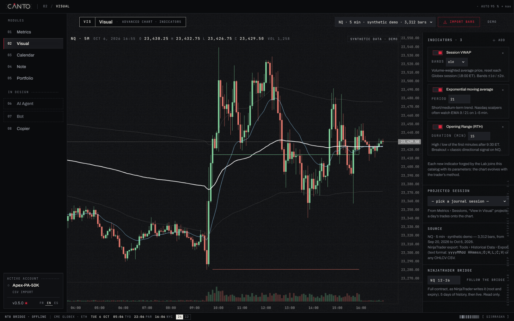

- Candles for the instrument registry — NQ, ES, RTY, YM, CL, GC, 6E and their micros — with volume, crosshair and trade markers.
- **Follow the bridge.** With the NinjaTrader WebSocket live, Visual asks for five days of history on the full contract (`NQ 12-26`), then subscribes to its live bars — only on your gesture. A silent feed is marked stale; **Stop following** unsubscribes. Nothing else subscribes, the agent included.
- An indicator **catalog**, not a frozen menu: EMA / SMA, session VWAP with ±σ bands, RTH opening range, previous-session levels, ATR, relative volume.
- From Metrics › Sessions › **View in Visual**, one day's trades are projected onto the chart. NinjaTrader *Historical Data* CSV files import directly.

<a id="calendar"></a>
<a id="03-cal"></a>

<div align="center">

**`03 · CAL · CALENDAR · OFFICIAL SOURCES · MARKERS`**

</div>

### Calendar

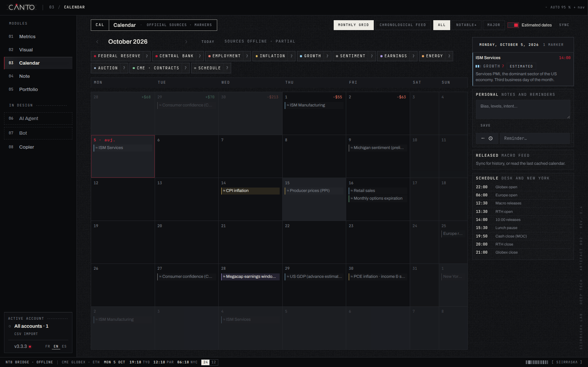

- Catalysts from the official pages — **BLS, BEA, the Federal Reserve, the ECB, EIA and TreasuryDirect** — with a 2026 snapshot inside the binary, so a fresh install still shows NFP and CPI when a host refuses. FRED only with a key you type.
- CME expirations and rollovers computed locally (marked estimated), US and EU clock changes, shortened sessions.
- Monthly grid or chronological feed, local and New York times, your journal P&L in each cell, and the note of the day beside it.

<a id="notes"></a>
<a id="04-nte"></a>

<div align="center">

**`04 · NTE · NOTE · NOTE VAULT · LINKS`**

</div>

### Notes

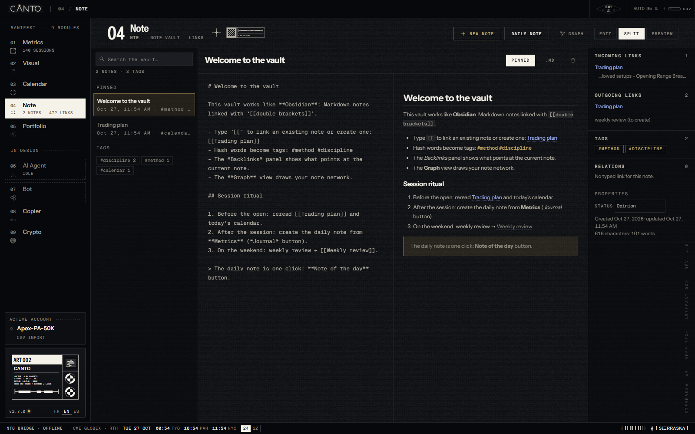

- A Markdown vault inside the desk: `[[wiki]]` links, backlinks, `#tags`, full-text search, a force-directed graph.
- The prefilled **note of the day**, and a **branch** from any selection: a child note with a question and an anchor, linked to its parent.
- A sanitized preview (no styles, forms or SVG; links limited to `http(s)`, `mailto` and anchors). Notes written by an agent are signed `agent`; a lesson enters your trading memory only once you adopt it.

<a id="portfolio"></a>
<a id="portefeuille"></a>
<a id="05-ptf"></a>

<div align="center">

**`05 · PTF · PORTFOLIO · SYNTHESIS · HEART · PROJECTION`**

</div>

### Portfolio

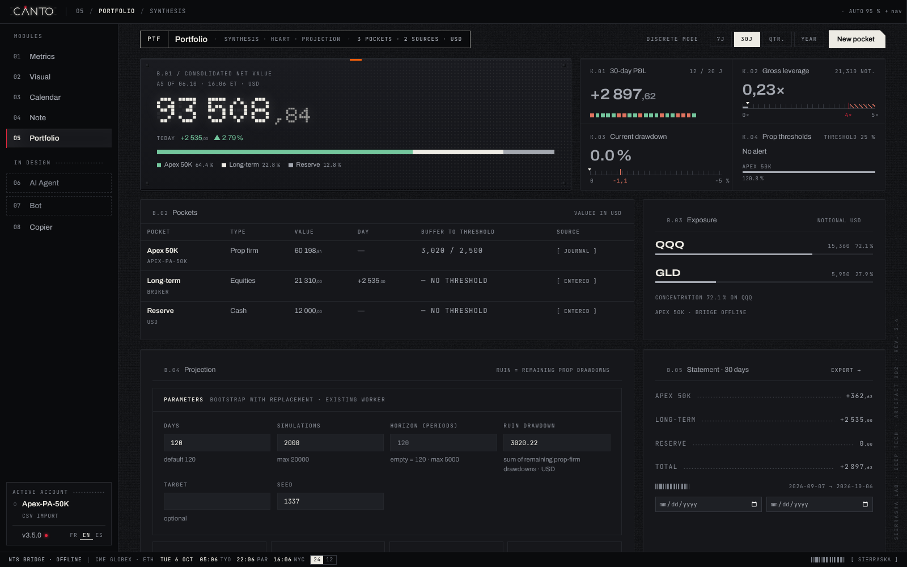

- **Net value** consolidated in a base currency, by pocket: prop-firm accounts from the journal, futures from a fresh bridge snapshot, securities and cash you enter.
- **Risk:** drawdown, gross leverage, concentration, and the distance of each prop pocket to its threshold.
- **Projection:** Monte Carlo on the consolidated daily P&L; ruin defaults to the sum of the remaining prop drawdowns.
- No quote feed, no broker. A missing exchange rate leaves its pocket out of the total — never converted at 1.

<a id="ai-agent"></a>
<a id="06-agt"></a>

<div align="center">

**`06 · AGT · AI AGENT · NATIVE GATEWAY · ORCHESTRATOR`**

</div>

### AI agent

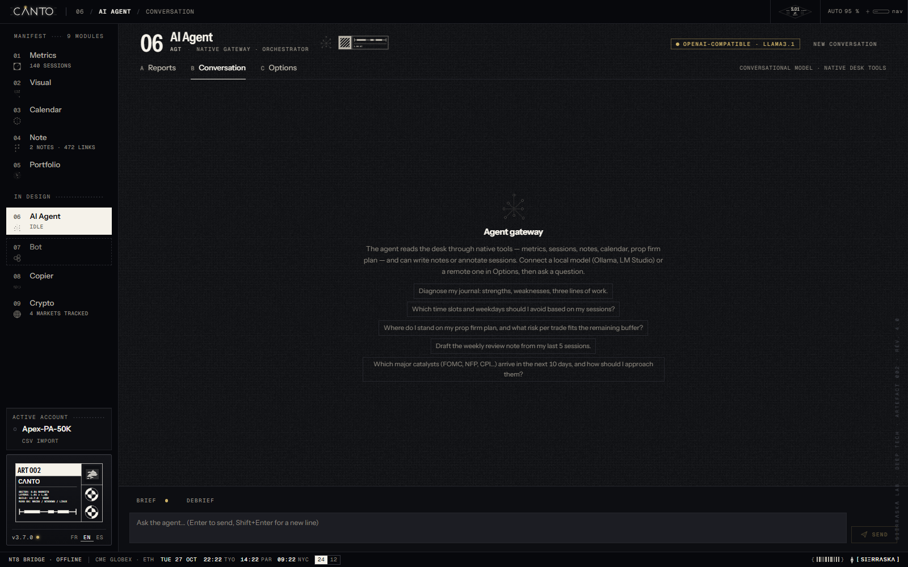

The embedded agent and any external MCP client read the desk through the same typed tools. Providers go through the main process: a local model (Ollama, LM Studio) or a cloud API with your own key. **How it reads, watches and proposes — and what stops it — is in [The agent](#the-agent).**

<a id="bot"></a>
<a id="07-bot"></a>

<div align="center">

**`07 · BOT · AUTOMATON WORKSHOP · DESIGN`**

</div>

### Bot

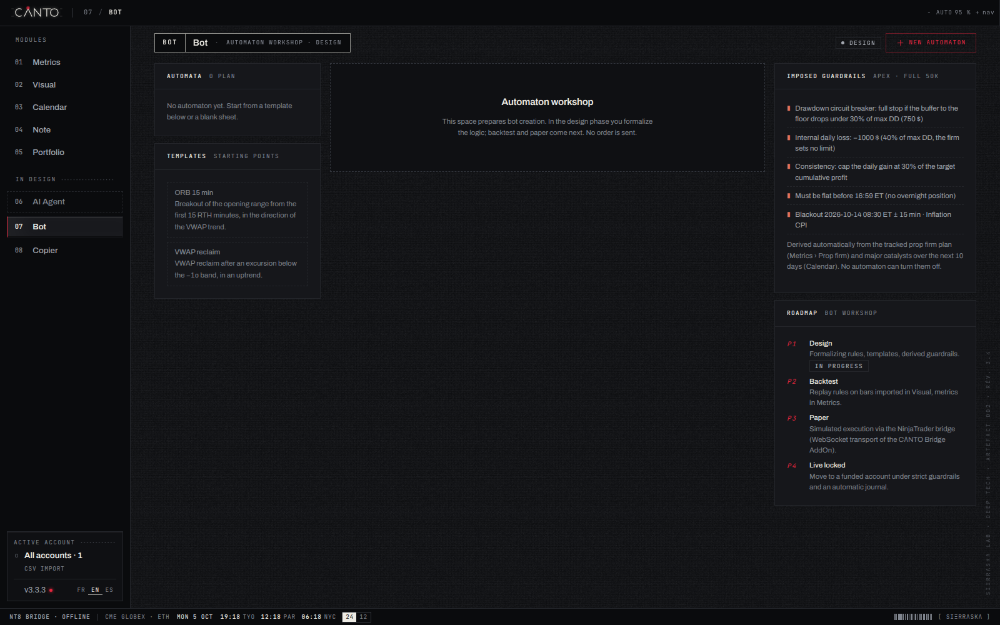

**Design phase: no order is sent.** The workshop formalizes an automaton (`draft → backtest → paper`) from templates — **ORB 15 min** and **VWAP reclaim** — under guardrails derived from the tracked prop plan and the calendar, which no automaton can turn off: a circuit breaker at 30 % of max drawdown, an internal daily loss, a consistency cap, flat before 16:59 New York, a blackout ±15 minutes around major catalysts.

<a id="copier"></a>
<a id="08-cpy"></a>

<div align="center">

**`08 · CPY · COPIER · SIM REPLICATION · DISARMED`**

</div>

### Copier

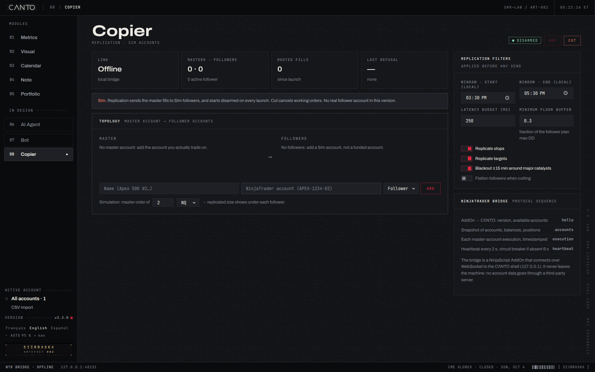

Replication runs in the main process on the execution port: each fill of the master brings every Sim follower to its own target position — not fill by fill — so an entry in three fills never triples a fixed size.

| Control | Behavior |
|---|---|
| **Sizing** | Master ratio, fixed size or contracts by risk; a contract cap per follower; NQ ↔ MNQ map |
| **Filters** | Local time window, latency budget, catalyst blackout, and the follower's prop floor: its dated buffer (the K.04 gauge, as the agent reads it) minus its unrealized loss, kept at 30 % of max drawdown or more by default |
| **Exits** | A reduction always goes out — outside the window, during a blackout, under the floor — and never beyond the follower's real position |
| **Arming** | Disarmed on every launch; **Arm** confirms in a main-process dialog (Cancel by default); **Cut** disarms and cancels working follower orders; flattening is an option, off by default |

Followers are `Sim*` accounts only, never the master and never twice. No real follower account in this version. Protocol and replication details: [docs/PONT-NINJATRADER.md](docs/PONT-NINJATRADER.md).

<a id="crypto"></a>
<a id="09-cry"></a>

<div align="center">

**`09 · CRY · CRYPTO · CHART · TEMPERATURE · ALERTS`**

</div>

### Crypto

**Optional, off by default.** The tab sits on the rail from the first launch, empty, with one action: **Turn on the crypto module**, confirmed in a main-process dialog (Cancel by default). Until then the desk opens no connection to an exchange and lists no crypto tool. Once on, the module stays on across launches until you click **Turn off the module** in the tab, which closes every feed at once.

- **A live chart.** The market you pick, in six timeframes from 1 minute to 1 day, with prices to the exchange's own tick size. Indicator cards as in Visual — EMA, SMA, VWAP and previous-day levels anchored at 00:00 UTC, ATR, relative volume — and the levels or zones an agent draws, marked AGENT.
- **CVD.** Complete from history where the exchange gives the buyer volume (Binance), and built from live trades elsewhere (Coinbase, Bybit), marked *since HH:MM*; for a Coinbase market that Binance also lists, a *CVD Binance* option adds a CVD with its full history.
- **Market temperature, from Binance.** The median funding of perpetual futures, the share of spot pairs up over 24 h, long and short liquidations over the rolling hour — a lower bound, and the screen says so — and the 24 h change in open interest. Every reading carries its time.
- **Local alerts.** On the price of a watched market or on the temperature (median funding, breadth, the last hour's liquidations), once or re-armed past a hysteresis band. The first reading sets the side; a crossing shows a desk message and raises a `crypto_alert` event the agent reads with `desk_events`. Nothing is evaluated on stale data, and there is no system notification: alerts run while the desk is open.
- **Read and driven by agents.** Ten `crypto_*` tools ([the list](#agent-tools)): the agent reads what you opened — a read never opens a feed — and can change the market, the timeframe, the indicators, the drawings, the alerts and the watchlist; a write that changes the market or the timeframe, the watchlist or the Binance CVD opens the matching feed. The embedded agent's writes wait for your confirmation; an MCP client's writes need *write allowed*, off by default.
- **Status lights.** One per exchange — connecting, live, reconnecting, stale, blocked — judged on the connection's activity, with the age of the last price shown separately: a quiet market can go minutes without a trade and still be live.

**What it never does.** No order, no account, no key, no position: the tab reads public exchange data, for personal use, through the main process only. Crypto stays out of Portfolio, discipline, the Copier, order execution and the NinjaTrader bridge. Bars stay in memory; the chart, the watchlist, the alerts and the drawings are kept in the local vault.

**Where it goes.** Crypto markets are listed one by one, release after release. The tab starts small on purpose and grows with each market added.

---

<a id="the-agent"></a>

## The agent

> The agent sees what you see, follows your rules, and never touches the market on its own.

- **Reads** — the whole desk through typed tools: journal, metrics, prop replay, calendar, notes, portfolio, bridge, market levels, your rules and your memory — and the crypto tab while it is on.
- **Watches** — desk events from the moment the desk opens: fills, order changes, prop-buffer and day-loss thresholds, rule breaches, a major catalyst 15 minutes ahead, crypto alerts.
- **Prepares** — the **morning brief** (8:30–9:30 New York) and the **evening debrief**, from the same texts as the MCP prompts — sent to the provider only when you click.
- **Proposes** — an order on a **Sim** account with `propose_order`. The main process guards it; you confirm it in a main-process dialog.

### An order, from proposal to market

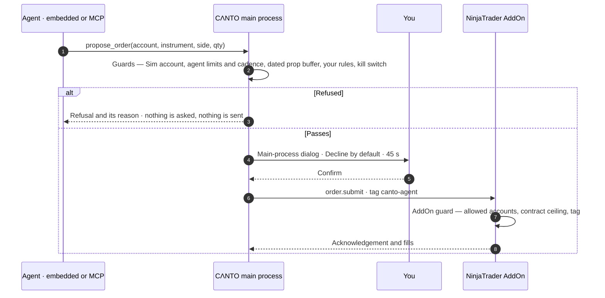

- **Guards before any dialog.** Sim accounts only; the agent's own limits (contracts per order, resulting position, proposals per minute); the tracked prop plan's dated buffer (the K.04 gauge, unrealized loss included) above 25 % of max drawdown; your rules — day loss reached, catalyst window, instrument not allowed. An order that reduces the position is exempt from the position cap, the prop buffer and your rules.
- **You decide.** Each order waits for you in a main-process dialog: 45 seconds, **Decline** by default. Agent-proposed orders are off each time the desk opens; turning them on, or raising the agent's limits, takes a main-process dialog — lowering a limit is immediate.
- **The agent never submits.** `copy.order` is not an agent tool; other writes — notes, links, annotations, crypto tab edits (chart, indicators, drawings, alerts, watchlist) — are confirmed by you, or allowed for external agents (MCP and orchestrator) by a flag that is off by default.

<a id="agent-tools"></a>

### Tools

<details>
<summary><b>33 desk tools</b> — 23 to read, 10 to write; 10 of them (5 read, 5 write) read and drive the crypto tab</summary>

<br/>

| Tool | Kind | Role |
|---|---|---|
| `desk_overview` | read | Metrics snapshot and the tracked plan, with its dated margin |
| `list_sessions` · `get_session` | read | Journal; each trade with its stop, target, risk and R |
| `search_notes` · `read_note` | read | Note vault |
| `calendar_events` | read | Official catalysts merged with local markers |
| `propfirm_status` | read | Replay of the tracked plan on the tracked account |
| `journal_breakdown` | read | By entry hour (New York), weekday of the CME session, instrument, long / short |
| `monte_carlo` | read | Bootstrap of daily P&L: percentiles, ruin, target (fixed seed) |
| `bridge_status` | read | Live NinjaTrader bridge and Copier: link, accounts, P&L, positions |
| `portfolio_snapshot` | read | Consolidated portfolio: net value, pockets, exposure |
| `market_levels` | read | Last price, PDH / PDL / PDC, opening range, VWAP, ATR — source named, demo marked synthetic |
| `day_context` | read | The day's context sheet: volatility regime and band, Garman-Klass volatilities, ATR, releases |
| `working_orders` | read | NinjaTrader working and recent orders, held by the main process |
| `market_quote` | read | The last quote received from the bridge; it never subscribes |
| `trader_memory` | read | Your rules, tracked plan, trading-plan note, adopted lessons and playbook |
| `discipline_status` | read | Today's CME day loss against its limit, trades against the maximum, drifts and breaches, next major catalyst |
| `desk_events` | read | Desk events since a cursor |
| `crypto_status` | read | The crypto tab: open or not, market, timeframe, a light per exchange, indicators and drawings |
| `crypto_chart_read` | read | The crypto chart on screen: last price, range, indicator values, the CVD and its source, up to 300 bars; it never opens a feed |
| `crypto_watchlist_get` · `crypto_alert_list` | read | Watched crypto markets with their last price; crypto alerts, and why one is not evaluated |
| `crypto_temperature` | read | Binance market temperature, each reading timed, liquidations marked as a lower bound |
| `create_note` · `branch_note` · `link_notes` | write | Notes and typed links, confirmed |
| `annotate_session` | write | A session annotation, confirmed |
| `propose_order` | write | An order proposed on a Sim account, confirmed in a main-process dialog |
| `crypto_chart_set` · `crypto_indicator_set` · `crypto_drawing_set` | write | Market and timeframe, indicators, levels and zones of the crypto chart |
| `crypto_alert_set` · `crypto_watchlist_set` | write | Crypto alerts and the crypto watchlist |

Embedded agent: 6 turns, 8 calls per turn, 2 writes per turn. Every client: `body` / `note` ≤ 20,000 characters. The embedded agent's tool results and the text of MCP results carry an *untrusted data* preamble; the orchestrator returns plain JSON-RPC results. Protocol: [docs/PROTOCOLE-AGENT.md](docs/PROTOCOLE-AGENT.md) · design rationale: [docs/THESE-AGENTIQUE.md](docs/THESE-AGENTIQUE.md).

</details>

<a id="mcp-gateway"></a>

### MCP gateway

External agents — **Claude Code, Claude Desktop, Codex, Cursor**, any MCP client — read the desk with the same tools at `http://127.0.0.1:47118/mcp` (desktop app only; `npm run dev` has no gateway).

- A bearer token kept in the desk's data folder, renewable; browser origins and non-loopback hosts refused; 1 MB per request, 40 requests per second.
- Write tools stay hidden and refused until you allow writing.
- The ten `crypto_*` tools are listed only while the crypto module is on, and refused otherwise; reconnect the client after turning the module on or off. Once a client is allowed to write, its crypto edits apply without a dialog in the desk.
- Tools titled and typed by the desk, with output schemas; `canto://` resources; three prompts — pre-session brief, session debrief, prop plan review; messages and refusals in the desk language.
- The gateway stays on the machine: no tunnel, no cloud connector. ChatGPT on the web calls MCP servers from OpenAI's cloud and cannot reach `127.0.0.1`.

<details>
<summary><b>Connect a client</b> — the panel copies these with your token</summary>

<br/>

**Claude Code**

```bash
claude mcp add --transport http canto http://127.0.0.1:47118/mcp --header "Authorization: Bearer <token>"
```

**`.mcp.json`** — Claude Code, Cursor and clients that read this format

```json
{
  "mcpServers": {
    "canto": {
      "type": "http",
      "url": "http://127.0.0.1:47118/mcp",
      "headers": { "Authorization": "Bearer <token>" }
    }
  }
}
```

**Claude Desktop** — through `mcp-remote`, the token in `env`

```json
{
  "mcpServers": {
    "canto": {
      "command": "npx",
      "args": [
        "-y", "mcp-remote", "http://127.0.0.1:47118/mcp",
        "--header", "Authorization:${CANTO_AUTH}"
      ],
      "env": { "CANTO_AUTH": "Bearer <token>" }
    }
  }
}
```

**Codex** — `~/.codex/config.toml`, the token exported as `CANTO_MCP_TOKEN`

```toml
[mcp_servers.canto]
url = "http://127.0.0.1:47118/mcp"
bearer_token_env_var = "CANTO_MCP_TOKEN"
```

</details>

### Providers and the orchestrator

The interface never calls a provider: chat and probes go through the main process, and the API key is encrypted by the operating system's keychain (`safeStorage`). Hosts are pinned in the main process — `127.0.0.1`, `localhost`, `api.openai.com`, `api.anthropic.com`, `openrouter.ai`, `api.moonshot.ai` — and the interface cannot widen the list. A key is bound to the host it was entered for and is never sent to another; a key saved by an older version follows the base URL until it is entered again.

The **orchestrator** is a JSON-RPC 2.0 WebSocket on `ws://127.0.0.1:47117` for an external agent that drives the desk: session token compared in constant time and never shown in the periodic status, browser origins refused, 8 clients, 1 MB per frame, 40 requests per second per client. It pushes desk events as `desk.event`.

---

<a id="ninjatrader-8-bridge"></a>
<a id="pont"></a>

## NinjaTrader 8 bridge

Two transports, both local. The **WebSocket** (`127.0.0.1`, default port **48231**) is a server of its own in `electron/nt-bridge/`, separate from the agent's gateways: the AddOn sends executions, accounts, bars, ticks and quotes, and accepts `order.submit`, `order.cancel` and `order.flatten`. The AddOn connects to `127.0.0.1` only, so real time — live bars, orders, the Copier — needs the desk on the Windows machine that runs NinjaTrader 8. The **CSV folder** is the fallback, and the only path for a desk on macOS or Linux: while the socket is live, a watched executions file imports only IDs the socket has not already seen; if the socket drops, the folder becomes the main path again with no action from you. The journal deduplicates on account and execution ID either way.

| Mode | How |
|---|---|
| **Real time** | On the Windows machine running NinjaTrader 8, copy `CantoBridge.cs` (`ninjatrader/` in the sources, `resources/ninjatrader/` in the installers) into `Documents/NinjaTrader 8/bin/Custom/AddOns/`, compile it in the NinjaScript Editor (F5), then **Write the NinjaTrader configuration** in the desk. Each execution is also appended to `executions-YYYY-MM-DD.csv`, atomically. |
| **Automatic** | Metrics › NinjaTrader bridge › folder — by default `Documents/NinjaTrader 8/export/CANTO` on macOS, Windows and Linux. Any finished `.csv` or `.txt` is imported once (SHA-256 of the stable file). |
| **Manual** | *Trade Performance* › Trades or Executions › Export CSV, then **Import a CSV**. |

Defaults: `Sim*` accounts, 20 contracts per order, mandatory tag, circuit breaker after 6 s of silence, kill switch <kbd>Ctrl</kbd>+<kbd>Shift</kbd>+<kbd>K</kbd> (<kbd>Cmd</kbd> on macOS). `scripts/fake-addon.mjs` speaks the same protocol without NinjaTrader. Guide: **[docs/PONT-NINJATRADER.md](docs/PONT-NINJATRADER.md)**.

---

<a id="safety-by-design"></a>

## Safety by design

A trading desk that can send orders earns trust by what it refuses to do. These invariants hold in the code, and none is relaxed without a written decision of the Lab.

| Area | What the desk guarantees |
|---|---|
| **Orders** | Accounts whose name starts with `Sim` by default; a live account only after an explicit main-process dialog. Contract ceiling from 1 to 1,000 (default 20); raising it takes a main-process dialog. Mandatory tag. Kill switch <kbd>Ctrl</kbd>+<kbd>Shift</kbd>+<kbd>K</kbd> (<kbd>Cmd</kbd> on macOS); after it, submission stays closed until the desk restarts. |
| **NinjaTrader AddOn** | Its own guard, read from `bridge.json`: allowed accounts, ceiling, tag. The token never travels — desk and AddOn prove they hold it by HMAC challenge–response — and the AddOn sends nothing and executes nothing before the desk has proven itself. |
| **Agent** | Never submits; `copy.order` is not an agent tool. `propose_order` passes the main-process guards — Sim accounts only, the agent's limits and cadence, the dated prop buffer (K.04), your rules, a channel closed after the kill switch; an order that reduces risk is exempt from the position cap, the prop buffer and your rules — then waits for your confirmation in a main-process dialog (Decline by default, 45 s). Other writes — notes, links, annotations, crypto tab edits — are confirmed by you, or allowed for external agents by a flag that is off by default. Agent-proposed orders are off at every launch; turning them on and raising the agent's limits each take a main-process dialog, while lowering a limit is immediate. It subscribes to no market data on its own: it reads what you opened, and a read never opens a feed. In the crypto tab, a write that changes the market or the timeframe, the watchlist or the Binance CVD has the desk open the matching feed — after your confirmation, or without a dialog for an external agent allowed to write. |
| **Bot** | Design only: no automaton sends an order. |
| **Copier** | Disarmed at every launch; Sim followers only, never the master or a duplicate; arming through a main-process dialog. A risk reduction is never blocked and never exceeds the follower's real position; an opening passes the follower's floor: its dated buffer (K.04), unrealized loss included. |
| **Crypto** | Off at the first launch, and until you consent in a main-process dialog (Cancel by default); turning it off closes every feed. Network only in the main process, to pinned exchange hosts over `https:` and `wss:` only, with no redirects and no credentials. Public data only — no order, no account. An agent's write can open a feed: see **Agent**. |
| **Keys and providers** | The API key stays in the main process, encrypted at rest; provider hosts are pinned and cannot be widened from the interface. |
| **Network** | The interface runs under a strict Content Security Policy — connections to the app itself and to the loopback only — and calls no outside host; providers and crypto exchanges go through the main process. The MCP gateway and the orchestrator listen on `127.0.0.1` only: no tunnel, no cloud connector. |
| **Updates** | An installer is installed only if `SHA256SUMS.txt` carries a signature from a Lab key embedded in the desk, bound to that version. The private key never touches the repository or GitHub. |
| **Data** | The journal lives in a local vault and needs no third-party server. No token, secret or key in a log, a vault export, or a commit. |

---

<a id="architecture"></a>

## Architecture

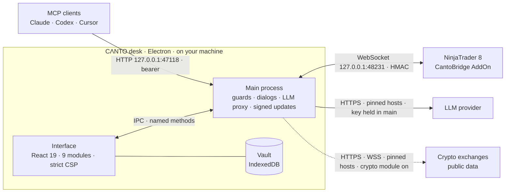

The engine (`src/engine`) is pure TypeScript and never imports the interface: metrics, prop firm, Monte Carlo, imports, portfolio, the instrument registry, the execution port, the copier router, indicators and agent tools, and, for crypto, the market registry, its indicators, the temperature and the alerts. Indicators, agent tools and prop plans are registries; agent tools receive injected **ports** rather than writing into the stores. The modules the main process runs are compiled from the same sources and guarded by the same tests.

<details>
<summary><b>Source tree</b></summary>

<br/>

```
electron/            shell: window, launcher, updates, dialogs, folder bridge, secrets,
                     LLM proxy, MCP gateway, orchestrator, crypto switch and feeds
electron/nt-bridge/  dedicated JSON-RPC server on 127.0.0.1:48231 (protocol, guards, copier host)
ninjatrader/         CantoBridge AddOn (atomic CSV and .seen file, WebSocket client)
src/app/             boot, gate, shell (title bar 44 · rail 220 · status 28), tabs
src/design/          tokens, primitives, CΛNTO wordmark, SVG charts
src/engine/          metrics, Monte Carlo, imports, prop firm, portfolio, instruments,
                     official calendar, execution port, copier, indicators, agent tools, crypto
src/store/           Dexie (IndexedDB) and Zustand stores
src/modules/         one folder per tab, 01 to 09
tests/               Vitest — engine, import, vault, calendar, bridge, agent, copier, portfolio, crypto, shell
vectors/             shared JSON vectors (trades and metrics, prop firm, portfolio, copier, execution guards)
docs/                DESIGN · PONT-NINJATRADER · PROTOCOLE-AGENT · THESE-AGENTIQUE · PUBLICATION · AUDIT
```

</details>

<a id="visual-system"></a>

### Visual system

System 3.4 — **[docs/DESIGN.md](docs/DESIGN.md)**. Carbon `#0A0B0D`, floor `#0F1013`, plate `#16171B`, graphite labels at 4.5:1 or more. Archivo for display and interface, Doto for one readout per screen, JetBrains Mono capitals for labels. The Lab LED `#E5263D` is a 5 px dot and its halo, never decoration. Chrome: title bar 44 · rail 220 · status 28.

---

<a id="develop"></a>
<a id="development"></a>

## Develop

```bash
npm install                # Node 22.12+
npm run launch             # launcher, then the desk (also CANTO.cmd · ./CANTO.sh · CANTO.command)
npm run desk:dev           # Electron and Vite, no launcher
npm run dev                # browser only: no gateways, no safeStorage encryption
npm run typecheck          # tsc, app and main process
npm test                   # Vitest
npm run check              # typecheck, tests, production build
npm run electron:compile   # main process (electron/), after any change there
npm run dist:mac           # universal DMG and zip (macOS)
npm run dist:win           # NSIS and portable, x64 and ARM64 (Windows)
npm run dist:linux         # AppImage and deb, x64 and ARM64 (Linux)
```

Installers land in `release/`, each built on its own OS.

**CI.** GitHub Actions on Ubuntu, Windows and macOS: `npm ci`, `npm audit --omit=dev --audit-level=high`, typecheck, tests, build, then each system's native installer, kept for a day only when the workflow is run by hand.

**Releases.** A `v*` tag, or *Actions › release › Run workflow*, builds the three installers straight into a draft Release with `changelog.json`, `SHA256SUMS.txt` and notes taken from the version journal; the workflow refuses a version without its journal entry in all three languages. The Lab then signs the sums with its Ed25519 key, offline, and only then publishes ([docs/PUBLICATION.md](docs/PUBLICATION.md)).

---

<a id="roadmap"></a>

## Roadmap

- The agent remains a prototype: it proposes, it never submits. Bot remains design: it sends no order.
- The Copier does not follow a real account in this version.
- NinjaTrader AddOn 2.3.0 (order fills and average price, a full bridge snapshot) ships only once it has been compiled and tried on Sim.
- The Lab's model joins the agent presets when its host opens.
- Crypto markets are added to the crypto tab one by one, release after release; the tab grows with them.

---

<a id="versions"></a>

## Versions

The journal inside the desk lists every release in French, English and Spanish.

- **3.7.0** — Visual system 4.0 « ΟΡΟΣ »: the Lab's night, ivory and gold; HUD plates bound to the desk's real state, cartouches and Ligne V2 components; the Horizon seal at start-up and on the lock; the status bar in the chassis black, signed with an eleven-bar code between braces; the AUBE launcher rebuilt around the dawn on the horizon. The kill-switch band shows even when the AddOn is not connected. (2026-10-26)
- <a id="whats-new-in-360"></a>**3.6.0** — Optional crypto tab `09 · CRY`, off until you consent in a main-process dialog: live markets with their CVD and the desk's indicators, the Binance market temperature, local alerts, ten `crypto_*` tools for the agent and MCP clients. Network in the main process only, to pinned exchange hosts. (2026-10-13)
- <a id="whats-new-in-350"></a>**3.5.0** — Metrics reworked: interactive equity curve, corrected figures, risk and R per trade, daily context, reading by context. The session in progress, discipline rules, Visual following the bridge. The agent reads your rules and day loss, prepares the brief and the debrief, and the desk refuses its proposed orders when they break your rules; the Copier's follower floor reads the same dated buffer. (2026-10-06)
- **3.4.0** — The agent reads the whole desk and proposes Sim orders that you confirm. Local MCP gateway. AddOn 2.2.0 and the desk prove themselves to each other, the Copier follows positions, updates are signed by the Lab. (2026-10-06)

<details>
<summary><b>Earlier versions</b></summary>

<br/>

- 3.3.4 — Update over 3.3.3. Desk Unlocked in the desk type; the loading bar writes the Lab name in characters. (2026-10-05)
- 3.3.3 — Desk Unlocked in the desk type. Red tip on the Λ. Compact module plate. (2026-10-05)
- 3.3.2 — PolyForm Noncommercial 1.0.0. Personal noncommercial use is free. Commercial use goes through the Lab. (2026-10-04)
- 3.3.1 — Lighter title bar, session clocks, account plate, and the Desk Unlocked opening. (2026-10-04)
- 3.3.0 — Execution port. Copier on the rail as `08 · CPY`, simulation only, disarmed on every launch. A note can branch another. The desk stays closed on arrival. (2026-10-04)
- 3.2.2 — New icon and logotype. Cleaner menu, thinner Lab signature plate. (2026-09-30)
- 3.2.1 — Lab signature plate, minus sign kept on negative amounts, installer checksums. (2026-09-30)
- 3.2.0 — System 3.4. Metrics and Portfolio redrawn. Portfolio moves to `05`. (2026-09-29)
- 3.1.0 — AUBE III launcher, version journal, MIT license. (2026-09-28)
- 3.0.0 — Portfolio module: consolidated net value, risk, projection. Security audit. (2026-09-27)
- 2.2.1 — AUBE II launcher. The desk still starts if the launcher moves to the background. (2026-09-26)
- 2.2.0 — Notes linked to sessions, trades, instruments, and the day's events. (2026-09-26)
- 2.1.0 — CME contract registry, official calendar, NinjaTrader bridge with the file as fallback. (2026-09-26)
- 2.0.2 — The desk opens on the launcher. Built-in update. (2026-09-25)
- 2.0.1 — Language choice on the launcher: French, English, Spanish. (2026-09-25)
- 2.0.0 — Native desk for macOS, Windows and Linux, with installers. (2026-09-23)
- 1.1.2 — Lab visual grammar, copier filters, NinjaTrader bridge specification. (2026-09-17)

</details>

---

<a id="disclaimer"></a>

## Disclaimer

> [!WARNING]
> CΛNTO gives no investment advice. The prop-firm registry is **indicative**: rules change often and must be confirmed with each firm. Whether an order proposed by an AI and confirmed by you is allowed depends on each prop firm's rules: CΛNTO makes no claim of compliance with any firm. Check with yours.

What the desk refuses to do — orders, the agent, Bot, the Copier, the crypto tab, the NinjaTrader bridge — is listed in [Safety by design](#safety-by-design).

---

<a id="license"></a>

## License

Personal noncommercial use of this desk is free under the [PolyForm Noncommercial License 1.0.0](LICENSE). Commercial use — resale, hosted services, and the services below — goes through SIΞRRΛSKΛ Lab under a separate agreement. Versions 3.1.0 through 3.3.1, published under the MIT license, remain under MIT. The names **CΛNTO** and **SIΞRRΛSKΛ**, and the visual identity, are outside this license.

<details>
<summary><b>Fonts</b> — shipped with the desk under the SIL Open Font License 1.1</summary>

<br/>

Copied next to the launcher at build time, with the license file beside each family. Bundling and redistribution with the desk are allowed.

| Family | Copyright | License file |
|---|---|---|
| Inter (variable, latin and greek) — launcher only | 2016 The Inter Project Authors | `electron/fonts/OFL-Inter.txt` |
| Archivo (variable, width axis) | 2020 The Archivo Project Authors | `electron/fonts/OFL-Archivo.txt` |
| Doto (variable) | 2024 The Doto Project Authors | `electron/fonts/OFL-Doto.txt` |
| JetBrains Mono (variable, latin and greek) | 2020 The JetBrains Mono Project Authors | `electron/fonts/OFL-JetBrainsMono.txt` |

</details>

<a id="services"></a>

### Services

A model reached through an API and run as a service, a desk fitted to one trader, and their deployment are commercial uses. The desk can already point at a provider you configure yourself; the Lab's service is the integration, the fit and the deployment. Write to the Lab on the repository: [github.com/0xSrk/C-NTO/issues](https://github.com/0xSrk/C-NTO/issues).

<div align="center">
<br/>

**`SIΞRRΛSKΛ—LAB · CΛNTO · ARTEFACT 002 · v3.7.0 · DESK OUTPUT`**

</div>
