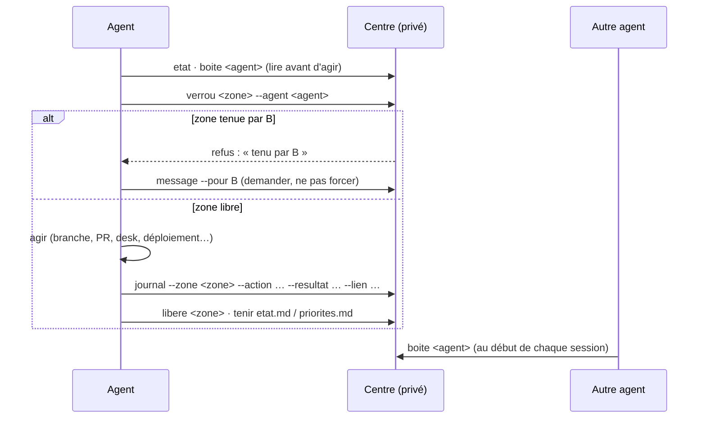

**`SIΞRRΛSKΛ—LAB · CΛNTO · CENTRE DE CONTRÔLE`**

# Centre de contrôle du Lab

Plusieurs agents travaillent sur CΛNTO : Claude Code dans le dépôt, Hermes sur le poste et dans la messagerie, et l'ADMIN qui décide. Le centre de contrôle est leur tableau commun. Chacun y lit l'état, les priorités et les points critiques, réserve une zone avant d'y toucher, écrit aux autres et consigne ce qu'il a fait. Personne ne marche sur le travail d'un autre.

Il a deux parties :

- **Le protocole** : ce document, public, dans le dépôt. Il ne contient aucune donnée vivante.
- **Le centre vivant** : un dossier privé sur le poste de l'ADMIN, `~/.canto-centre` (ou `$CANTO_CENTRE`), **jamais dans le dépôt**. Le dépôt est public : rien de ce qui est dans le centre n'en sort.

`scripts/centre.mjs` est le seul outil qui écrit dans le centre. Il pose les verrous de façon atomique, horodate tout et refuse tout texte qui ressemble à un secret.

---

## 1. Couloirs

| Acteur | Couloir par défaut |
|---|---|
| **Claude Code** | Le code du dépôt : branches, PR, tests, documentation du dépôt. Le pilotage du desk ouvert, à la demande de l'ADMIN. |
| **Hermes** | Le poste et la messagerie : veille, rappels, relais avec les testeurs, tâches de l'ADMIN hors du dépôt. |
| **ADMIN** | Les décisions, la fusion dans `main`, la version, le tag, la Release, les signatures et les clés (`CLAUDE.md` § 3). |

Une tâche qui traverse un couloir passe par un message dans la boîte de son propriétaire. Personne n'entre de lui-même dans le couloir d'un autre.

## 2. Le dossier

```
~/.canto-centre/
├── LISEZMOI.md          le rappel des règles
├── etat.md              l'état de CΛNTO : versions, branches et PR, desk, agent cloud, sièges
├── priorites.md         - [ ] P0 · titre · propriétaire · échéance
├── critique.md          ce qui peut casser, coûter ou exposer, tant que le risque reste
├── verrous/<zone>.verrou   une zone réservée : agent, depuis, expire, motif
├── boites/
│   ├── claude/          un fichier par message, en tête : de, pour, date, priorité, sujet, état
│   ├── hermes/
│   └── admin/           ce qui attend l'ADMIN : décisions, fusions, signatures
├── journal/AAAA-MM-JJ.md   une ligne par action, en ajout seul
└── archives/<agent>/    les messages traités
```

`etat.md`, `priorites.md` et `critique.md` sont tenus à la main par qui change l'état. Les verrous, les messages et le journal ne s'écrivent qu'avec `scripts/centre.mjs`.

## 3. Le cycle d'une action



- **Lire avant d'agir.** Au début de chaque session, puis avant toute action dans une zone partagée : `etat`, sa boîte, `priorites.md` et `critique.md`.
- **Réserver.** Un verrou par zone. Il expire de lui-même (4 h par défaut, `--heures` pour ajuster). Son agent le prolonge en le reposant. Un verrou tenu par un autre ne se force pas : on lui écrit. Un verrou périmé ne se reprend qu'avec `--reprendre`, après avoir écrit à son agent.
- **Consigner.** Chaque action d'une zone partagée laisse une ligne au journal, avec son résultat et son lien (PR, commit, Release).
- **Libérer.** Le verrou se lève dès la fin. Seul son agent, ou l'ADMIN, le lève.

## 4. Zones

| Zone | Ce qu'elle couvre |
|---|---|
| `depot-main` | Le checkout du desk de l'ADMIN et la branche `main` : pull, fusion, fichiers de travail. |
| `desk-ouvert` | Le desk lancé : le piloter, le relancer, le fermer. |
| `agent-cloud` | Le déploiement Managed Agents : installer, mettre à jour, lancer, suspendre, quitter. |
| `release` | La version, le tag, le workflow `release` et la Release. |
| `sieges` | L'émission d'un code de siège (`docs/SIEGE-NOMINATIF.md`). |
| `cles` | Tout fichier de clé : publication, siège, API. |
| `readme` | Le README et ses visuels. |
| `design` | Le système visuel (`docs/DESIGN.md`). |

Une zone nouvelle s'écrit en minuscules, chiffres et tirets, et s'ajoute ici.

## 5. Messages et priorités

Un message par fichier, dans la boîte de son destinataire. Son en-tête porte `de`, `pour`, `date`, `priorite`, `sujet` et `etat`. Traité, il part aux archives (`boite <agent> --traite <fichier>`).

| Priorité | Sens |
|---|---|
| **P0** | Bloquant ou risqué maintenant : sécurité, dépense, desk ou ordres. À traiter avant tout. |
| **P1** | Pour la prochaine version ou dans la journée. |
| **P2** | À faire, sans échéance proche. |
| **P3** | Idée, remarque. |

## 6. Protection des données

- **Aucun secret dans le centre.** Ni clé d'API, ni jeton, ni clé privée, ni ligne de siège `SIEGE1.`, ni mot de passe ou code de déverrouillage. On écrit **où** il se trouve, jamais sa valeur. `scripts/centre.mjs` refuse un texte qui en a la forme. Cette garde rattrape une erreur ; elle ne remplace pas la règle.
- **Rien du centre ne sort.** Ni dans le dépôt, ni dans un commit, une PR, une issue ou un commentaire. La documentation du dépôt reste générique. Le script refuse un centre placé dans le dépôt.
- **Les personnes.** Un testeur se nomme par son pseudonyme, jamais par une donnée personnelle (nom civil, adresse, téléphone, compte de courtage).
- **Les clés restent à l'ADMIN.** Une clé privée de publication ou de siège ne passe par aucune session d'agent, Hermes compris (`CLAUDE.md` § 3). Si l'ADMIN en décide autrement, il l'écrit dans `critique.md`, avec la date.

## 7. Commandes

```
node scripts/centre.mjs init
node scripts/centre.mjs etat
node scripts/centre.mjs verrou <zone> --agent <claude|hermes|admin> [--motif "…"] [--heures 4] [--reprendre]
node scripts/centre.mjs libere <zone> --agent <agent>
node scripts/centre.mjs message --de <agent> --pour <agent> --sujet "…" [--priorite P0|P1|P2|P3] [--corps "…"]
node scripts/centre.mjs boite <agent> [--traite <fichier>]
node scripts/centre.mjs journal --agent <agent> --zone <zone> --action "…" [--resultat "…"] [--lien "…"]
```

Le centre se crée par `init`, qui ne réécrit jamais un fichier existant. Les tests (`tests/centre.test.ts`) tiennent l'exclusivité des verrous, la garde des secrets, le refus d'un centre dans le dépôt, les boîtes et le journal.
